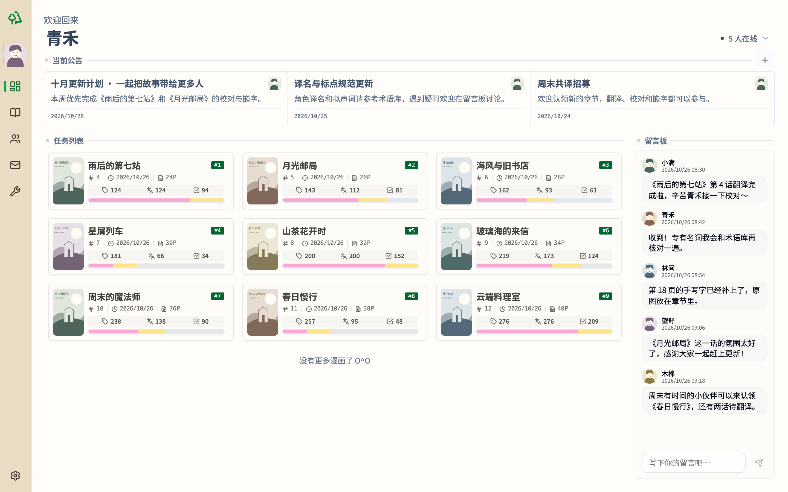
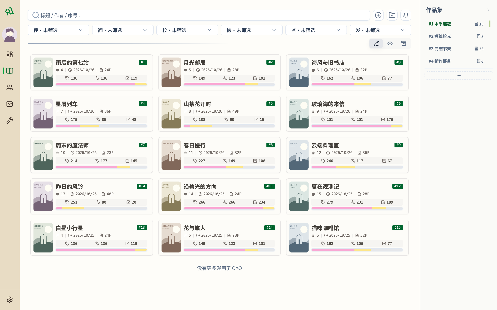
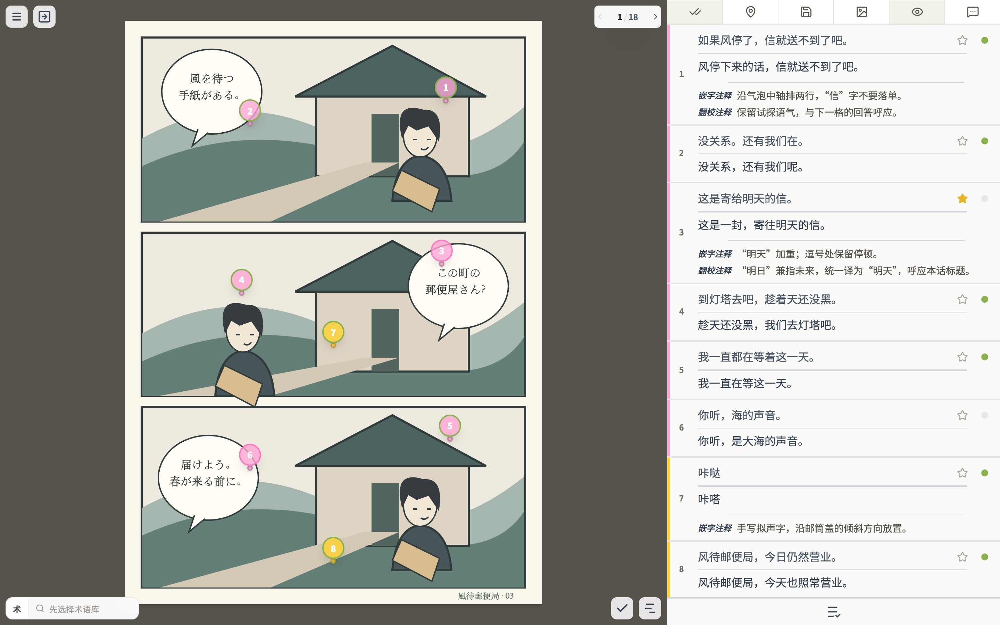
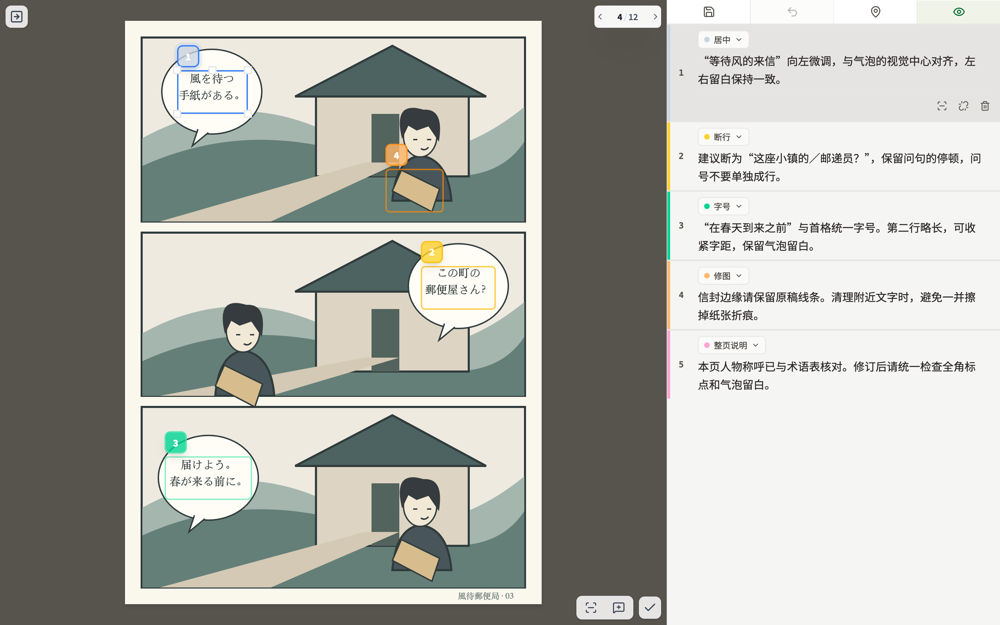
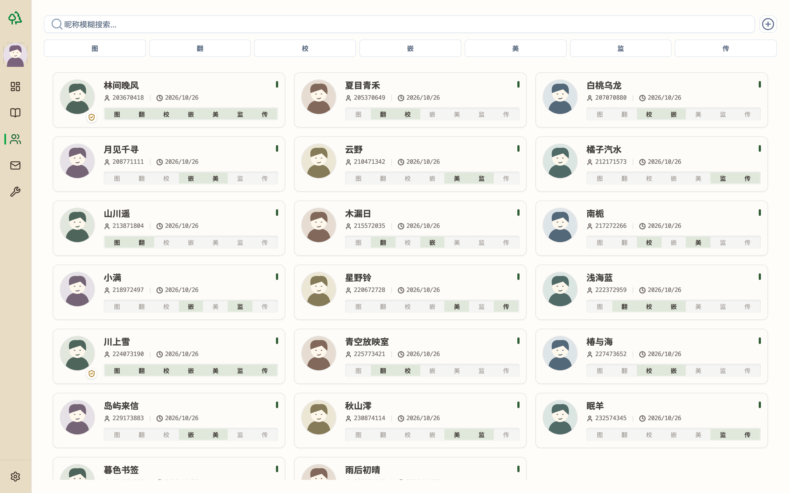
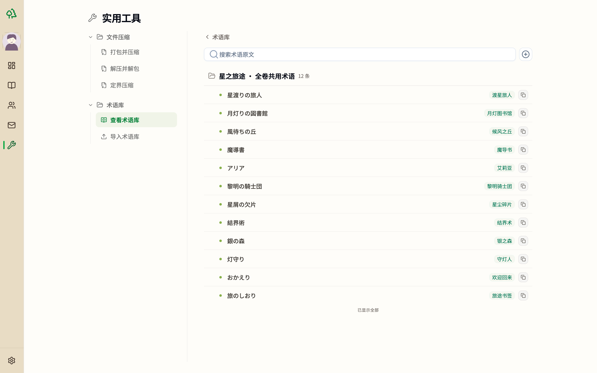

# PopRaKo Web

白杨子生态的 Web 客户端，让漫画翻译、校对、嵌字与监修在云上协作完成。

[在线使用](https://poprako.com) · [更新记录](CHANGELOG.md) · [反馈问题](SUPPORT.md) · [参与贡献](CONTRIBUTING.md)

## 页面预览

### 个人工作区

### 漫画广场

### 翻校器

整页预览（校对模式）：

翻校单元列表细观：

### 监修器

### 成员列表

### 实用工具

## 功能亮点

- **多组协作**：不同汉化组拥有独立空间，按成员分工管理权限与任务。
- **连载管理**：按漫画、章节组织项目，记录各个汉化环节的进度、时间与耗时。
- **在线翻校**：在浏览器中看图翻译、切换校对模式，配合术语库、快捷字符、特殊标记与结构化注释。
- **嵌字交付**：PSD 压缩上云，集中上传和交付章节成稿。
- **在线监修**：直接在成稿上框选批注，让修改意见对应到具体位置。
- **漫画归档**：导出漫画 ZIP 归档，并在漫画广场浏览已归档作品。

## 致谢

感谢电容、[Pkuism](https://github.com/pkuislm)、[星辰大海](https://github.com/SeaAndStars)、秋叶声生，以及
[萌翻](https://github.com/moeflow-com/moeflow)、[LabelPlus](https://github.com/LabelPlus/LabelPlus) 等开源项目。
字体采用 Adobe [思源黑体](https://github.com/adobe-fonts/source-han-sans)。

## 许可证

Copyright (c) 2026 PopRaKo contributors.

[AGPL-3.0-only](LICENSE)。字体及第三方依赖许可见[第三方许可说明](docs/third-party-licenses.md)。
